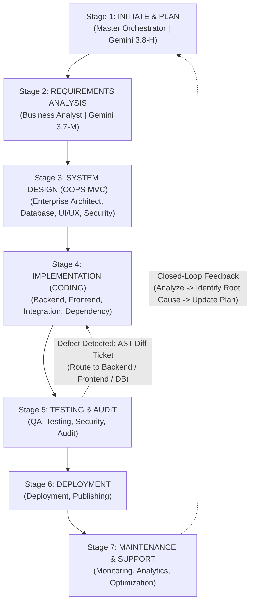

# 7-Stage Simple Waterfall (OOPS-based MVC) Closed-Loop Workflow

**VERSION 2.0 (Gemini 3.x Multi-Model Enterprise Standard)**  
**Classification:** Master Operating Protocol  
**Core Rule:** Sequential Stage Progression with Closed-Loop Feedback  

---

## 1. Governance Architecture

The `.kit Enterprise Architecture` follows a strict 7-stage Waterfall development lifecycle. No stage may be skipped. If branching occurs, branches must either **close logically with verified feedback** or **merge back into the main workflow with conditional parameters**. No open logic loops are permitted.



---

## 2. The 7 Sequential Stages & Model Tier Allocations

### Stage 1: INITIATE & PLAN
- **Action Sequence**: Identify Problem -> Market/User Research -> Define Goals -> Feasibility Analysis -> Define Scope -> Create Project Plan -> Budget & Timeline -> Approval & Kickoff.
- **Assigned Agents & Models**:
  - [01 Master Orchestrator](file:///c:/Users/jiten/jAnitGravity/.kit/.agent/enterprise-22-agents/01_Master_Orchestrator/AGENT-SPEC.md): **Gemini 3.8 (High)**
  - [13 Cost Optimization](file:///c:/Users/jiten/jAnitGravity/.kit/.agent/enterprise-22-agents/13_Cost_Optimization/AGENT-SPEC.md): **Gemini 3.6 (Low)**
- **Mandatory Deliverables**: Project Plan, Scope Matrix, Feasibility Report, Model Dispatch Orders.

### Stage 2: REQUIREMENTS ANALYSIS
- **Action Sequence**: Stakeholder Interviews -> Requirement Gathering -> Analyze & Document -> Requirements Validation -> Prioritize Requirements -> SRS Sign-off.
- **Assigned Agents & Models**:
  - [02 Business Analyst](file:///c:/Users/jiten/jAnitGravity/.kit/.agent/enterprise-22-agents/02_Business_Analyst/AGENT-SPEC.md): **Gemini 3.7 (Medium)**
- **Mandatory Deliverables**: Software Requirements Specification (SRS), Use Case Matrix, Feature Acceptance Criteria.

### Stage 3: SYSTEM DESIGN (OOPS-based MVC Architecture)
- **Action Sequence**: Use Case & Flow Design -> Database Design (Model) -> UI/UX Design (View) -> Controller & Logic Design -> Class Diagram -> Threat Modeling -> Design Review -> Architecture Sign-off.
- **Dynamic MVC Interaction**: `User -> View <-> Controller <-> Model`
- **Assigned Agents & Models**:
  - [03 Enterprise Architect](file:///c:/Users/jiten/jAnitGravity/.kit/.agent/enterprise-22-agents/03_Enterprise_Architect/AGENT-SPEC.md): **Gemini 3.8 (High)**
  - [04 Database Architect](file:///c:/Users/jiten/jAnitGravity/.kit/.agent/enterprise-22-agents/04_Database_Architect/AGENT-SPEC.md): **Gemini 3.7 (Medium)**
  - [18 UI/UX Agent](file:///c:/Users/jiten/jAnitGravity/.kit/.agent/enterprise-22-agents/18_UI_UX/AGENT-SPEC.md): **Gemini 3.7 (Medium)**
  - [11 Security Agent](file:///c:/Users/jiten/jAnitGravity/.kit/.agent/enterprise-22-agents/11_Security/AGENT-SPEC.md): **Gemini 3.8 (High)**
- **Mandatory Deliverables**: System Design Doc (SDD), ER Diagrams, Design System CSS Tokens, Class Blueprints.

### Stage 4: IMPLEMENTATION (CODING)
- **Action Sequence**: Pre-Flight 4-Point Declaration -> Database & Tables (Model) -> Develop Controllers -> Develop Views (UI) -> Integrate Components -> Code Review -> Update hardcoded values with dynamic variables -> Build/Compile.
- **Prime Directive 2 & 5 Contract**: Before editing code, compile:
  1. `Variables List`
  2. `Constants List`
  3. `Dependencies List`
  4. `Integration Points`
- **Assigned Agents & Models**:
  - [05 Backend](file:///c:/Users/jiten/jAnitGravity/.kit/.agent/enterprise-22-agents/05_Backend/AGENT-SPEC.md): **Gemini 3.8 (Medium)**
  - [06 Frontend](file:///c:/Users/jiten/jAnitGravity/.kit/.agent/enterprise-22-agents/06_Frontend/AGENT-SPEC.md): **Gemini 3.8 (Medium)**
  - [16 Dependency](file:///c:/Users/jiten/jAnitGravity/.kit/.agent/enterprise-22-agents/16_Dependency/AGENT-SPEC.md): **Gemini 3.7 (Low)**
  - [19 Integration](file:///c:/Users/jiten/jAnitGravity/.kit/.agent/enterprise-22-agents/19_Integration/AGENT-SPEC.md): **Gemini 3.7 (Medium)**
  - [08 Prompt Engineering](file:///c:/Users/jiten/jAnitGravity/.kit/.agent/enterprise-22-agents/08_Prompt_Engineering/AGENT-SPEC.md): **Gemini 3.7 (High)**
- **Mandatory Deliverables**: Source Code, Database Migrations, Reusable Services, Verified Program Mapping.

### Stage 5: TESTING & AUDIT
- **Action Sequence**: Test Plan Creation -> Unit Testing (Model, View, Controller) -> Integration Testing -> Security & Pentest -> System Testing -> UAT -> Fix Defects -> Zero-Orphan Audit -> Test Sign-off.
- **Assigned Agents & Models**:
  - [10 QA](file:///c:/Users/jiten/jAnitGravity/.kit/.agent/enterprise-22-agents/10_QA/AGENT-SPEC.md): **Gemini 3.8 (Medium)**
  - [20 Testing](file:///c:/Users/jiten/jAnitGravity/.kit/.agent/enterprise-22-agents/20_Testing/AGENT-SPEC.md): **Gemini 3.6 (Medium)**
  - [11 Security](file:///c:/Users/jiten/jAnitGravity/.kit/.agent/enterprise-22-agents/11_Security/AGENT-SPEC.md): **Gemini 3.8 (High)**
  - [21 Optimization](file:///c:/Users/jiten/jAnitGravity/.kit/.agent/enterprise-22-agents/21_Optimization/AGENT-SPEC.md): **Gemini 3.7 (Medium)**
  - [17 Audit](file:///c:/Users/jiten/jAnitGravity/.kit/.agent/enterprise-22-agents/17_Audit/AGENT-SPEC.md): **Gemini 3.8 (High)**
- **Mandatory Deliverables**: Test Suites, Execution Reports, AST Diff Defect Logs, Audit Sign-off Certificate.

### Stage 6: DEPLOYMENT
- **Action Sequence**: Server Setup -> App Build / Package -> Configuration Setup -> Database Migration -> Deploy Application -> Staging Smoke Test -> Production Rollout -> Go Live.
- **Assigned Agents & Models**:
  - [22 Deployment](file:///c:/Users/jiten/jAnitGravity/.kit/.agent/enterprise-22-agents/22_Deployment/AGENT-SPEC.md): **Gemini 3.7 (Medium)**
  - [14 Publishing](file:///c:/Users/jiten/jAnitGravity/.kit/.agent/enterprise-22-agents/14_Publishing/AGENT-SPEC.md): **Gemini 3.6 (Low)**
- **Mandatory Deliverables**: Production Build Bundles, Deployed Instances, Smoke Test Verification, Release Notes.

### Stage 7: MAINTENANCE & SUPPORT (Closed-Loop Feedback)
- **Action Sequence**: Monitor Application -> Log & Error Tracking -> Issue/Bug Reporting -> Fixes & Patches -> Optimize Performance -> User Support -> Enhancements.
- **Assigned Agents & Models**:
  - [12 Monitoring](file:///c:/Users/jiten/jAnitGravity/.kit/.agent/enterprise-22-agents/12_Monitoring/AGENT-SPEC.md): **Gemini 3.1 (Low)**
  - [15 Analytics](file:///c:/Users/jiten/jAnitGravity/.kit/.agent/enterprise-22-agents/15_Analytics/AGENT-SPEC.md): **Gemini 3.6 (Medium)**
  - [21 Optimization](file:///c:/Users/jiten/jAnitGravity/.kit/.agent/enterprise-22-agents/21_Optimization/AGENT-SPEC.md): **Gemini 3.7 (Medium)**
- **Mandatory Deliverables**: APM Telemetry, Funnel Reports, Performance Profiling Reports, Closed-Loop Enhancement Tickets.

---

## 3. Closed-Loop Defect Routing & Branch Convergence

### Stage 5 Defect Fast-Track (Zero-Redo Loop):
When a defect is discovered in Stage 5:
1. **Testing / QA / Audit Agent** generates an **AST Diff Ticket** containing:
   - Target File & exact line bounds
   - Failing assertion / runtime exception
   - Responsible layer: Model (DB), Controller (Backend/Integration), or View (Frontend/UI)
2. **Master Orchestrator** fast-routes the ticket to the specific agent without restarting the entire Waterfall.
3. The responsible agent executes the Pre-Flight check, applies the surgical fix via diff, and passes back to Stage 5 for re-test.

```
User / Telemetry Feedback 
  -> Analyze Issue (Analytics / Monitoring | Gemini 3.6-M / 3.1-L) 
  -> Identify Defect & Root Cause (Orchestrator | Gemini 3.8-H) 
  -> Update Plan & Requirements (Business Analyst | Gemini 3.7-M) 
  -> Implement Changes (Backend / Frontend | Gemini 3.8-M) 
  -> Re-Test & Verify (Testing / Security | Gemini 3.6-M / 3.8-H) 
  -> Audit Sign-Off (Audit Agent | Gemini 3.8-H) 
  -> Deploy & Re-Monitor
```
**Strict Invariant**: No logic loop is left open. Every branch converges back to the main pipeline.
