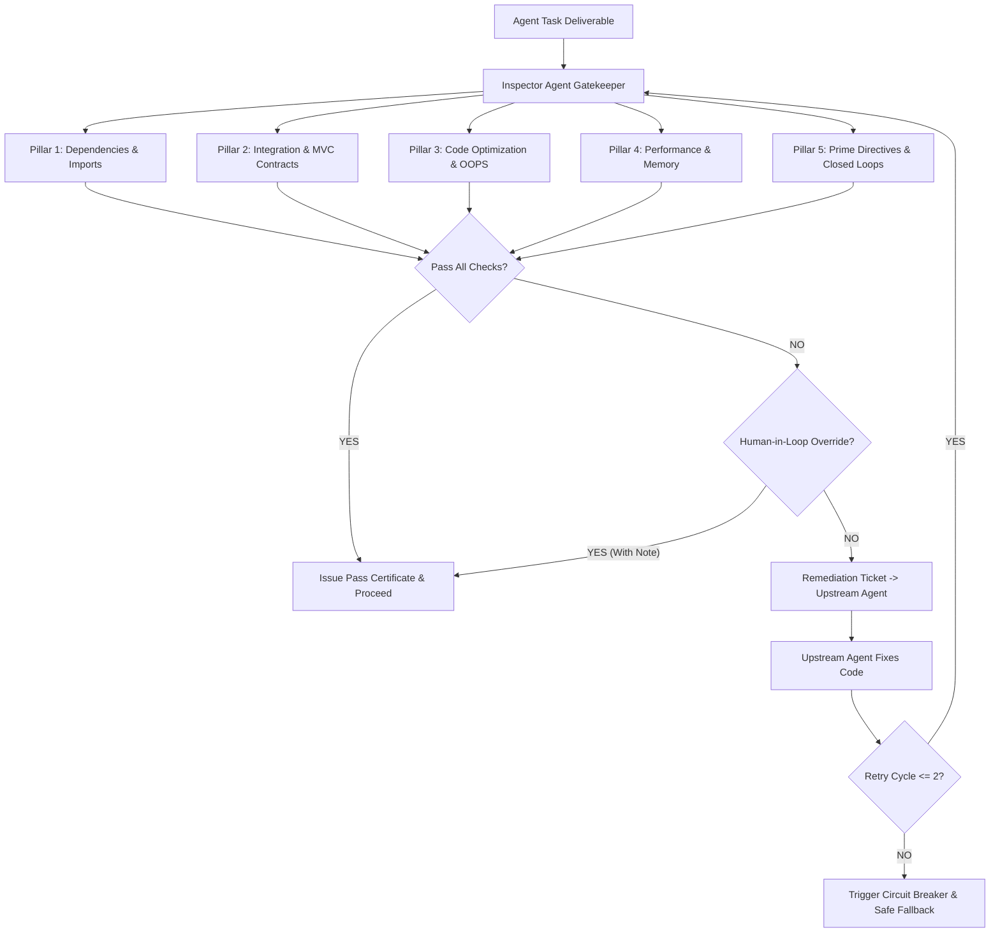

# /checklist-inspector: Automated Agent Inspector & Quality Gatekeeper

When invoked (`/inspect`, `/audit`, or `/checklist-inspector`), activate **Agent-17 (Audit & Checklist Inspector Agent)** to run systematic verification on any modified screen, agent deliverable, or full pipeline.

---

## 🏛️ The 5-Pillar Verification Process



---

## 📋 The 5-Pillar Inspector Checklist

### 1. Pillar 1: Dependencies & Imports
1. **Unresolved References:** Scan all files for missing imports, incorrect relative paths, or broken symbol imports.
2. **Manifest Alignment:** Ensure every external package is listed in `package.json` / build manifests.
3. **Dead Code Elimination:** Remove unused imports, unreferenced variables, and dead stub modules.
4. **Duplicate Prevention:** Avoid importing conflicting libraries for identical purposes.

### 2. Pillar 2: Integration & Contracts (MVC Architecture)
1. **API Contracts:** Verify endpoint paths, HTTP verbs, and payload fields match between frontend views and backend controllers.
2. **Model Synchronization:** Ensure SQL/ORM schemas correspond to backend data objects and frontend interfaces.
3. **Robust Fault Tolerance:** Ensure graceful degradation for network loss, 500 errors, rate-limiting, and null data.
4. **Dynamic Settings Integration:** Ban hardcoded API tokens, database paths, or service endpoints; read from dynamic settings.

### 3. Pillar 3: Code Optimization & Dynamic OOPS Hygiene
1. **Call-by-Reference:** Reuse existing shared utilities, services, and base classes to prevent code duplication.
2. **Zero Stubs/TODOs:** Ban placeholder comments (`// TODO`), dummy return values, or unimplemented functions.
3. **Strict Layering:** Maintain clean MVC separation (View $\leftrightarrow$ Controller $\leftrightarrow$ Model).
4. **Single Source of Truth:** Sync all newly introduced flags with `PROGRAM-MAPPING.md` and database settings.

### 4. Pillar 4: Performance & Resource Footprint
1. **Memory & Timer Hygiene:** Clear intervals, event listeners, and socket subscriptions upon unmount.
2. **Query & Network Optimization:** Verify indexed queries, pagination, and compressed responses.
3. **Ponytail Ladder Compliance:** Choose the leanest native solution before adding complex dependencies.
4. **Server Uptime Sanity:** Verify background servers remain operational with HTTP 200 health responses.

### 5. Pillar 5: Prime Directives & Closed-Loop Convergence
1. **Prime Directive 1 (Chesterton's Fence):** Never delete working code. Deprecations must be updated and merged.
2. **Deterministic Branch Convergence:** Every conditional execution branch must close or merge back with feedback.
3. **Loop Circuit Breaker:** Max 2 retry cycles per agent failure. After 2 failures, trigger circuit breaker.
4. **Human-in-the-Loop Review:** Surface clear pass/fail status, detailed logs, and manual override capability.

---

## 🛡️ Standardized Inspector Scorecard Output

```markdown
### 🛡️ AGENT INSPECTOR AUDIT REPORT
**Target Agent / Feature:** @[Agent Name] — [Target Module / Screen]
**Evaluation Timestamp:** [ISO Timestamp]

| Check Pillar | Status | Findings / Violations |
| :--- | :---: | :--- |
| **1. Dependencies & Imports** | ✅ PASS / ❌ FAIL | [Details] |
| **2. Integration & Contracts** | ✅ PASS / ❌ FAIL | [Details] |
| **3. Code Optimization & OOPS**| ✅ PASS / ❌ FAIL | [Details] |
| **4. Performance & Memory** | ✅ PASS / ❌ FAIL | [Details] |
| **5. Closed-Loop & Directives** | ✅ PASS / ❌ FAIL | [Details] |

**Verdict:** [APPROVED / REJECTED / HITL_OVERRIDE]
**Remediation Action:** [Explicit line numbers & exact required fix]
```
