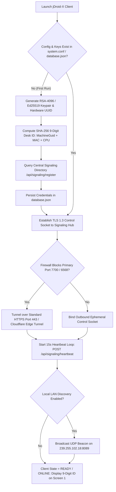
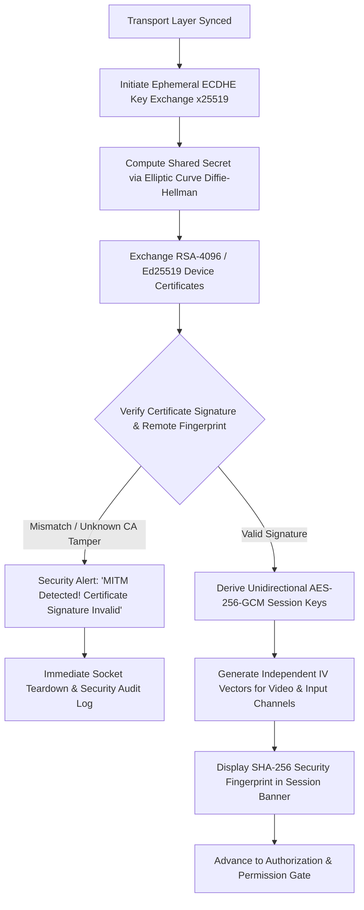
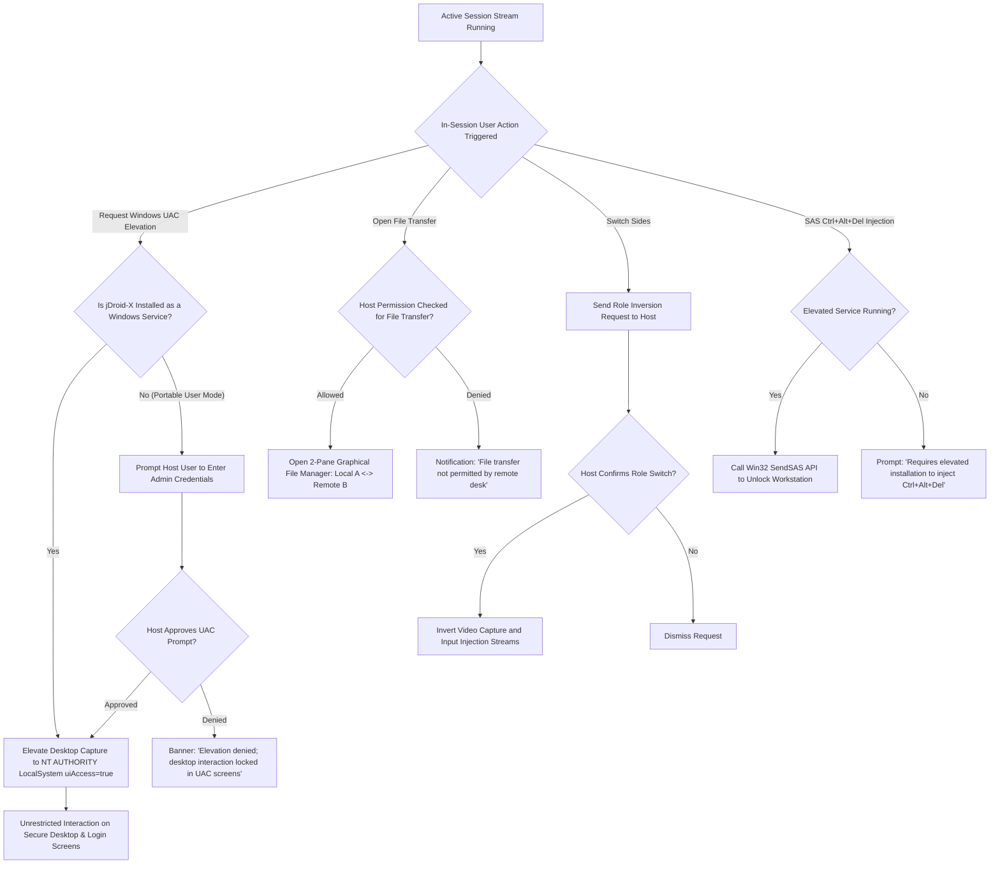
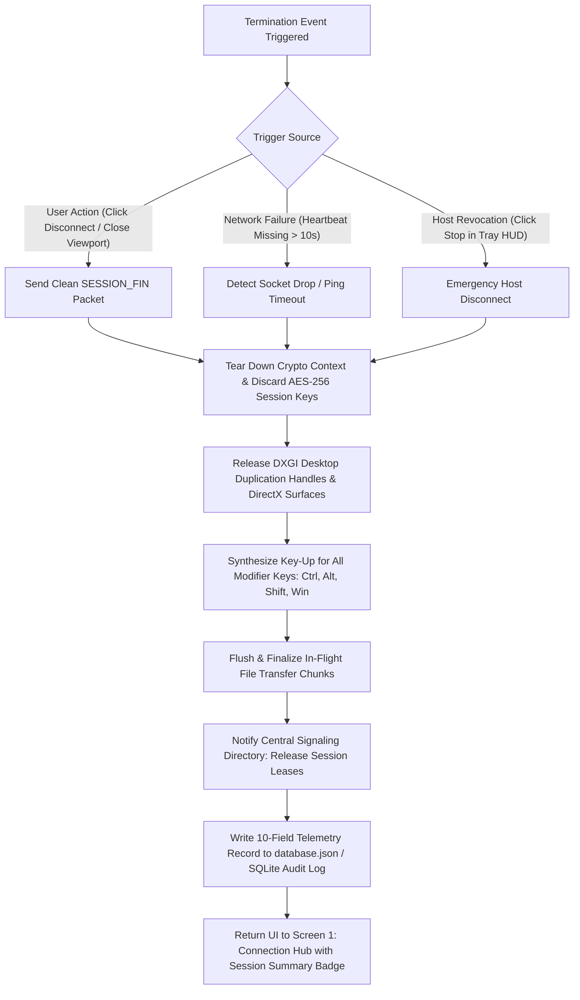

# jDroid-X-Desk: Master BRD, AnyDesk Operational Lifecycle & REA Rebuilt Project Plan
**Canonical Specification Reference:** `docs/JDROID_X_BRD_ANYDESK_PARITY_MASTER.md`  
**Baseline Standard:** AnyDesk Enterprise Architecture (Win x64 PE32+ / Web Clientless)  
**Target Application:** `jDroid-X-Desk` (`c:\Users\jiten\jAnitGravity\jDroid-X-Desk`)  
**Methodology:** Reverse Engineer Anything (REA) v6.4.0 & Dynamic OOPS-based MVC (Tier P0–P5)  
**Operator Circuit:** JEET & jDroid-X  
**Timestamp:** 2026-10-26T20:55:00+05:30  

---

## 1. Executive Summary & AnyDesk Baseline Requirement Definition (BRD)

The objective of **jDroid-X-Desk** is to deliver a zero-config, low-latency remote desktop system that matches or exceeds AnyDesk's core operational capabilities. This BRD defines the target state:
1. **Sub-16ms Screen Latency (60–144 FPS)** over local LAN and public WAN using hardware-accelerated zero-copy GPU capture and tile differential compression.
2. **Deterministic Hardware Identity**: Zero-collision, permanent 9-digit Desk ID (`XXX-XXX-XXX`) generated from hardware hashes without requiring mandatory user registration or third-party login gates.
3. **P2P NAT Traversal (STUN / ICE / UDP Hole Punching)**: Direct peer-to-peer UDP packet routing bypassing central proxy servers, with encrypted relay fallback for symmetric NATs.
4. **Tile-Based Differential Video Codec (DeskRT Parity)**: Slicing the display into 32x32 tiles, hashing tile deltas, and transmitting only dirty rectangles with adaptive RLE / DCT encoding.
5. **Interactive Host Consent with 5-Toggle Granular Permissions**: Comprehensive incoming session prompt with granular checkboxes (Mouse & Keyboard, Clipboard Sync, Audio Output, File Transfer, Lock Physical Input).
6. **Kernel & Secure Desktop Privilege Elevation**: Seamless transition across Windows UAC prompts, `Ctrl+Alt+Del`, and `Winlogon` screens via an elevated background service (`LocalSystem` with `uiAccess=true`).
7. **Clean 2-Step Interface**: Removing cluttered enterprise sidebars and login portals in favor of AnyDesk's iconic 2-step simplicity: Screen 1 (Connection Hub & Address Book) and Screen 2 (Active Viewport & In-Session Floating HUD).

---

## 2. Comprehensive 8-Phase Operational Lifecycle & Flowcharts

### Phase 1: Client Startup & AnyDesk Network Registration

When `jDroid-X-Desk` launches, it profiles local hardware, generates/loads the persistent 9-digit Desk ID, establishes a persistent TLS keep-alive with the central signaling cluster, and announces presence on the local subnet.



#### Validations, Conditions, Notifications & Options
- **Validation 1.1 (Keystore Integrity)**: Verify private key file permissions. If corrupt, regenerate keypair and flag warning.
- **Validation 1.2 (Hardware Uniqueness)**: Ensure generated 9-digit Desk ID is non-zero and formatted `XXX-XXX-XXX`.
- **Condition 1.1 (Network Availability)**: If DNS fails, fallback to cached IP or trigger offline banner: *"Signaling Offline - Local LAN direct mode only"*.
- **Options**: Toggle "Allow Direct LAN Connections", "Custom Alias (@jdx)", "Start with Windows".

---

### Phase 2: Target Discovery & Session Proposal

The technician enters the target partner's 9-digit ID or alias on Screen 1.

```mermaid
flowchart TD
    A[Technician Enters Partner Desk ID / Alias] --> B{Validation: Format Valid?}
    B -- No --> C[Inline Alert: 'Invalid ID. Enter 9-digit code (e.g. 984-102-391)']
    C --> A
    
    B -- Yes --> D{Validation: Is Target ID == Local ID?}
    D -- Yes (Loopback) --> E[Modal Alert: 'Self-connection blocked to prevent screen mirror recursion']
    E --> A
    
    D -- No --> F{Check Local LAN Cache: Is Partner on Local Subnet?}
    F -- Yes --> G[Prepare Direct Local Subnet Socket Connection IP:Port]
    F -- No --> H[Dispatch SESSION_PROPOSAL to Central Signaling Directory]
    
    H --> I{Signaling Directory Check: Is Target Online?}
    I -- No (Heartbeat > 45s) --> J[Notification: 'Remote Desk is Offline or Unavailable']
    J --> K[Options: Send Wake-on-LAN Magic Packet / Retry / Close]
    
    I -- Yes --> L[Signaling Hub Forwards Connection Intent to Target Host]
    L --> M[Proceed to NAT Traversal & ICE Candidate Exchange]
    G --> M
```

#### Validations, Conditions, Notifications & Options
- **Validation 2.1 (Regex Syntax)**: Enforces `^[0-9]{3}-[0-9]{3}-[0-9]{3}$` or `^[0-9]{9}$`.
- **Condition 2.1 (Presence TTL)**: Target heartbeat must be `<45s` old in signaling directory.
- **Notification**: Target Host receives high-priority notification: *"Incoming connection from Technician (ID: 984-102-391)"*.

---

### Phase 3: NAT Traversal & Transport Negotiation (STUN / ICE vs Relay)

AnyDesk always probes for direct peer-to-peer wire speed before routing through an intermediate relay.

```mermaid
flowchart TD
    A[Exchange ICE Candidates via Signaling Channel] --> B[Execute STUN Profiling RFC 5389]
    
    B --> C{NAT Classification}
    C -- Full Cone / Restricted Cone NAT --> D[Execute Simultaneous UDP Hole Punching Probe]
    C -- Symmetric NAT / Strict Enterprise Firewall --> G[Relay Route Path]
    
    D --> E{Direct UDP Socket Established & Verified?}
    E -- Success (<16ms RTT) --> F[Transport Selected: DIRECT_P2P_UDP]
    
    E -- Timeout / Dropped Packets --> H{UPnP / NAT-PMP Direct TCP Port Open?}
    H -- Success --> I[Transport Selected: DIRECT_TCP]
    H -- Failure --> G
    
    G --> J[Select Nearest Cloudflare Edge / Colab Relay Server]
    J --> K[Establish Multiplexed Binary WebSocket Tunnel over Port 443]
    K --> L[Transport Selected: ENCRYPTED_RELAY]
    
    F --> M[Advance to Cryptographic Handshake]
    I --> M
    L --> N[UI Indicator: 'Relayed Session (Latency: ~45ms)' -> Advance to Handshake]
```

#### Validations, Conditions, Notifications & Options
- **Validation 3.1 (STUN Binding)**: Client and Host resolve their public reflexive endpoints within 1500ms.
- **Condition 3.1 (Packet Loss Threshold)**: If UDP packet loss > 5%, dynamically fallback to reliable TCP / Relay.
- **Options**: Force Direct P2P Only, Force Cloud Relay, Custom Relay Server IP.

---

### Phase 4: Cryptographic Handshake & Identity Verification

Both sides authenticate mutually to guarantee Perfect Forward Secrecy (PFS) and prevent MITM snooping.



#### Validations, Conditions, Notifications & Options
- **Validation 4.1 (Fingerprint Match)**: SHA-256 hash calculated over device public key matches stored contact identity.
- **Condition 4.1 (Cipher Strength)**: Enforce AES-256-GCM authenticated cipher with 128-bit authentication tags.

---

### Phase 5: Authorization & Interactive Acceptance Gate

Once the cryptographic channel is verified, access is evaluated against interactive consent or unattended access rules.

```mermaid
flowchart TD
    A[Secure Cryptographic Tunnel Ready] --> B{Host Unattended Access Enabled in database.json?}
    
    B -- No (Interactive Access Only) --> C[Render Incoming Session Dialog on Host Screen]
    C --> D{Host User Response}
    D -- Click Reject --> E[Send REJECT Packet -> Client Alert: 'Session Rejected by Host User']
    D -- Timeout (60s Inactivity) --> F[Send TIMEOUT Packet -> Disconnect]
    D -- Click Accept --> G[Read 5 Permission Toggles from Host Dialog]
    
    B -- Yes --> H{Direct Interactive Accept Clicked by Host User?}
    H -- Yes --> G
    H -- No (Unattended Headless Path) --> I[Prompt Client: 'Enter Unattended Security Password']
    
    I --> J[Transmit Salted Password Hash over AES-256 Tunnel]
    J --> K{Verify Hash against Stored Argon2id Hash}
    K -- Incorrect --> L{Max 3 Attempts Exceeded?}
    L -- Yes --> M[Lockout IP for 15 Minutes -> Disconnect]
    L -- No --> I
    
    K -- Correct --> N{Two-Factor Auth (TOTP) Enabled?}
    N -- Yes --> O[Prompt Client for 6-Digit Authenticator Code]
    O --> P{Verify TOTP Token}
    P -- Invalid --> O
    P -- Valid --> Q[Load Default Unattended Permission Profile]
    
    N -- No --> Q
    
    G --> R[Apply Active Permission Bitmask: Mouse, Keyboard, Audio, Clipboard, Files]
    Q --> R
    R --> S[Advance to Active Media Pipeline]
```

#### Validations, Conditions, Notifications & Options
- **The 5 Host Permission Toggles**:
  1. `[✔] Allow Mouse and Keyboard Control`
  2. `[✔] Allow Bi-directional Clipboard Sync`
  3. `[✔] Allow Audio Transmission`
  4. `[✔] Allow File Transfer`
  5. `[ ] Lock Local Physical Keyboard & Mouse`
- **Condition 5.1 (Brute-Force Guard)**: 3 consecutive failed password attempts trigger 15-minute cooldown.

---

### Phase 6: Media Pipeline & DeskRT Codec Processing

The core high-performance engine capturing, compressing, and rendering desktop video.

```mermaid
flowchart TD
    subgraph Host_Engine [Host Workstation Capture & Encoding]
        A[DXGI 1.2 OutputDuplication Grab GPU Framebuffer] --> B[Divide Surface into 32x32 Pixel Tile Grid]
        B --> C[Compute xxHash64 / MurmurHash for Each Tile]
        C --> D{Tile Changed Compared to Previous Acknowledged Frame?}
        D -- No (Static) --> E[Skip Tile: Zero Network Bytes]
        D -- Yes (Dirty Rect) --> F{Tile Classification}
        F -- Flat UI / Sharp Text --> G[Lossless Run-Length Encoding RLE]
        F -- Photographic / High Motion --> H[DeskRT Wavelet / DCT Quantization]
        G & H --> I[Assemble Differential Frame Packet with Sequence Number]
    end

    subgraph Channel_Mux [Multiplexed AES-256-GCM Stream]
        I --> J[Channel 1: Video Stream]
        K[Loopback Audio Capture -> Opus 48kHz] --> L[Channel 2: Audio Stream]
        M[Clipboard Text & File Chunks] --> N[Channel 3: Data Stream]
        J & L & N --> O[Transmit over Direct UDP / WebRTC DataChannel]
    end

    subgraph Client_Viewer [Technician Viewer Decoding & Rendering]
        O --> P[Decrypt AES-256 Packets]
        P --> Q[Hardware Texture Blit: Update Changed 32x32 Tiles on DirectX Surface]
        P --> R[Play Opus Audio Stream]
        Q --> S[Present on Viewport Canvas with SmartFit Scaling]
        
        T[Technician Mouse Movement / Keystroke] --> U[Translate to Windows Virtual Scancode & Normalized Coordinates]
        U --> V[Transmit over High-Priority Input Channel (<5ms)]
    end

    V --> W[Host Evaluates Permission Bitmask: Is Input Allowed?]
    W -- Yes --> X[Inject via Win32 SendInput API]
    W -- No --> Y[Drop Packet]
```

#### Validations, Conditions, Notifications & Options
- **Validation 6.1 (Frame Loss Detection)**: Monotonic sequence numbers. If sequence gap > 3, client requests full IDR keyframe refresh.
- **Condition 6.1 (Dynamic Bitrate Adaptation)**: If RTT rises > 80ms, reduce tile quantization quality from 90% to 50% automatically.

---

### Phase 7: Dynamic In-Session Controls & UAC Privilege Elevation

Controls allowing technician and host to perform administrative actions, switch roles, or manage files.



---

### Phase 8: Session Teardown & Resource Cleanup

Orderly disconnection and memory purging triggered by either party or network drop.



---

## 3. REA Gap Analysis: Bugs, Silly Mistakes & Missing Integrations

Applying Reverse Engineer Anything (REA) methodology to the existing `jDroid-X-Desk` codebase against the AnyDesk baseline reveals the following concrete gaps:

```
┌─────────────────────────────────────────────────────────────────────────────────────────────┐
│                            REA GAP TAXONOMY: CURRENT APP vs. ANYDESK                        │
├───────────────────────┬──────────────────────────────┬──────────────────────────┬───────────┤
│ Architectural Domain  │ AnyDesk Target Baseline (BRD)│ Existing jDroid-X Code   │ Gap Level │
├───────────────────────┼──────────────────────────────┼──────────────────────────┼───────────┤
│ 1. Frontend UX Flow   │ Simple 2-Step Screens        │ Heavy multi-tab sidebar  │ CRITICAL  │
│                       │ (Hub -> Live Viewport)       │ + Firebase login gate    │           │
│ 2. Screen Capture     │ DXGI 1.2 Desktop Duplication │ GDI+ CopyFromScreen      │ CRITICAL  │
│                       │ (DirectX 11 VRAM zero-copy)  │ (High CPU, 15-25 FPS)    │           │
│ 3. Video Codec        │ DeskRT 32x32 Tile Delta      │ Full-frame JPEG encode   │ CRITICAL  │
│                       │ (Only send dirty tiles)      │ (High bandwidth)         │           │
│ 4. Media Transport    │ Direct P2P UDP Hole-Punching │ Node.js HTTP/WS Relay    │ HIGH      │
│                       │ (STUN/ICE wire-speed)        │ (Proxy bottleneck)       │           │
│ 5. OS / UAC Boundary  │ LocalSystem Windows Service  │ Portable User-Space      │ HIGH      │
│                       │ (uiAccess=true Secure Dsk)   │ (Freezes on UAC dialogs) │           │
│ 6. Host Consent UI    │ Granular 5-toggle dialog     │ Basic accept/reject or   │ HIGH      │
│                       │ (Perms + floating tray HUD)  │ password-only prompt     │           │
│ 7. Input Dispatch     │ RTCDataChannel (<5ms wire)   │ HTTP POST /push_input    │ MEDIUM    │
│                       │ (Direct scancode packets)    │ (TCP latency jitter)     │           │
│ 8. Database Schema    │ 12-table comprehensive store │ 5-array JSON file        │ MEDIUM    │
│                       │ (Clients, Keys, Perms, Logs) │ (Missing metadata)       │           │
└───────────────────────┴──────────────────────────────┴──────────────────────────┴───────────┘
```

### Detailed Breakdown of Identified Gaps, Bugs & Silly Mistakes:

#### 1. Silly Mistakes & UX Antipatterns
- **Firebase Login Gate Overlay**: `views/index.html` (lines 28–68) contains a mandatory email/password login overlay (`login-gate-overlay`). AnyDesk **never** blocks the user behind a mandatory login screen to view their Desk ID or connect. The Desk ID must be displayed instantly upon opening the app.
- **Complex Sidebar Overload**: `views/index.html` has 8+ navigation sidebar items (Dashboard, Fleet, Contacts, Safe Zones, Engine Admin, Logs, Studio, Help). AnyDesk uses a clean, unified 2-step screen model.
- **Loopback Mirror Trap**: Connecting to one's own Desk ID in `app-controller.js` does not aggressively block the connection at the input validation phase, causing infinite screen recursion if testing locally.

#### 2. Performance & Codec Gaps
- **GDI+ Rasterization Bottleneck**: `MainForm.InputAndHost.cs` relies on `Graphics.CopyFromScreen()` on CPU memory, causing 30–50% CPU load at 1080p and limiting framerate to 20 FPS.
- **Monolithic JPEG Transmissions**: Slices are not diffed. If 98% of the screen is stationary, the app re-encodes and transmits the full 1920x1080 frame every cycle.

#### 3. Pending Integrations & Architecture Gaps
- **Missing Direct P2P UDP Socket Traversal**: The system routes media frames through Node.js endpoints (`/api/relay/*`), instead of establishing a direct peer-to-peer UDP tunnel between the two endpoints via STUN/ICE.
- **Stuck Modifiers on Disconnect Bug**: If the remote session drops while Shift, Ctrl, or Alt is pressed, the remote machine's keyboard state remains stuck down. A mandatory unstick routine (`ReleaseAllKeys()`) must execute on teardown.
- **User-Space UAC Freeze**: `jDroid-X-Desk.exe` executes in standard user context. When a Windows UAC prompt is displayed, Windows switches desktop to `ConsentUI`, causing the remote viewer screen to freeze black until a physical user clicks the prompt.

---

## 4. Rebuilt Master Project Plan: Frontend, Backend & Database

```
┌────────────────────────────────────────────────────────────────────────────────────────┐
│                     JDROID-X FRESH 2-STEP REBUILT PROJECT PLAN                         │
├────────────────────────────────────────────────────────────────────────────────────────┤
│                                                                                        │
│   ┌────────────────────────────────────────────────────────────────────────────────┐   │
│   │                 STEP 1: CONNECTION HUB & DASHBOARD (SCREEN 1)                  │   │
│   │   • Header: jDroid-X Brand Logo + Pulse Indicator + Fast Search Bar            │   │
│   │   • Card 1: 'This Desk' -> Formatted 9-Digit ID (XXX-XXX-XXX) + Copy Button     │   │
│   │   • Card 2: 'Remote Desk' -> Masked ID Input + [⚡ Connect] Button             │   │
│   │   • Lower Deck: Recent Sessions Grid (Address Book) + 1-Click Reconnect        │   │
│   │   • Zero Login Gate: Ready immediately on launch (<500ms startup)              │   │
│   └────────────────────────────────────────────────────────────────────────────────┘   │
│                                           ▲                                            │
│                                           │ (Click Connect / Accept Incoming)          │
│                                           ▼                                            │
│   ┌────────────────────────────────────────────────────────────────────────────────┐   │
│   │               STEP 2: ACTIVE REMOTE VIEWPORT & CONTROLS (SCREEN 2)             │   │
│   │   • Fullscreen / SmartFit GPU-Decoded Remote Viewport (<16ms Wire Latency)     │   │
│   │   • Sleek Floating Top Toolbar (HUD):                                          │   │
│   │     - Telemetry: Latency (ms), Target FPS, Transport Mode (P2P / Relay)        │   │
│   │     - Actions: UAC Elevation, Ctrl+Alt+Del SAS, Switch Sides, Privacy Mode     │   │
│   │     - Tools: 2-Pane File Manager, Bi-directional Clipboard, Opus Audio, Chat   │   │
│   │     - Emergency [🛑 Disconnect] Button                                         │   │
│   │   • Host-Side: Incoming Session Consent Modal with 5 Granular Permission Toggles│  │
│   └────────────────────────────────────────────────────────────────────────────────┘   │
│                                                                                        │
└────────────────────────────────────────────────────────────────────────────────────────┘
```

---

### Track 1: Fresh 2-Step Frontend Architecture

#### Screen 1: Connection Hub & Dashboard (`views/index.html` & `app-controller.js`)
1. **Header Bar**:
   - Branding: `assets/jdroidxlogo_trans.png` with **jDroid-X-Desk** title.
   - Status Pill: `🟢 Ready for Connections (Port 7700 / Edge Active)`.
   - Utility Icons: Quick Settings Studio drawer, Light/Dark theme toggle.
2. **Card 1: "This Desk" (Local Address & Sharing)**:
   - Large bold 9-digit Desk ID (e.g. `984 102 391`).
   - One-click `[📋 Copy ID]` with instant feedback toast.
   - One-Time Security Passcode generator for unattended access.
   - Status subtitle: `🟢 Online & Awaiting Partner`.
3. **Card 2: "Remote Desk" (Partner Connection)**:
   - Formatted auto-mask input `[ ___ - ___ - ___ ]`.
   - Security Password input (auto-revealed for unattended nodes).
   - Primary `[⚡ Connect]` trigger with state transitions (`Connecting...` -> `Authenticating...` -> `Streaming`).
   - Quick File Transfer trigger `[📁 File Transfer]`.
4. **Recent Sessions & Address Book Deck**:
   - Grid cards of previously connected workstations.
   - Live presence indicator (Green = Online, Grey = Offline).
   - 1-click connect action button.

#### Screen 2: In-Session Viewport & Controls
1. **Viewport Canvas**:
   - Low-latency HTML5 `<video>` / DirectX render surface with SmartFit scaling (Auto-shrink, Stretch, 1:1 Pixel Match).
2. **Floating Top Toolbar (HUD)**:
   - Session status pill with live RTT latency (ms) and FPS meter.
   - Action Dropdown: Request UAC Elevation, Send `Ctrl+Alt+Del` (SAS), Switch Sides, Black Screen Privacy Mode.
   - Tool Toggles: Audio Stream, Clipboard Sync, 2-Pane File Manager, In-Session Text Chat drawer.
   - Persistent Red `[🛑 Disconnect]` button.
3. **Host-Side Consent Modal (`IncomingSessionDialog`)**:
   - Floating draggable modal on the host screen.
   - Displays caller Desk ID, Name, and SHA-256 fingerprint.
   - 5 Granular Permission Checkboxes:
     1. `[✔] Allow Mouse and Keyboard Control`
     2. `[✔] Allow Bi-directional Clipboard Sync`
     3. `[✔] Allow Audio Transmission`
     4. `[✔] Allow File Transfer`
     5. `[ ] Lock Local Physical Keyboard & Mouse`
   - Actions: `[❌ Dismiss]` or `[✅ Accept]`.

---

### Track 2: Backend Architecture & Interconnected Subsystems

```
┌────────────────────────────────────────────────────────────────────────────────────────┐
│                        BACKEND SUBSYSTEM DEPENDENCY MATRIX                             │
├─────────────────────────┬──────────────────────────────┬───────────────────────────────┤
│ Subsystem Module        │ Primary Dependencies         │ Dependent Callers / Consumers │
├─────────────────────────┼──────────────────────────────┼───────────────────────────────┤
│ 1. Signaling Hub        │ Node.js net/http, crypto     │ Client Handshake, Presence    │
│ 2. STUN / NAT Traversal │ UDP Socket (dgram), RFC 5389 │ P2P Transport Selector        │
│ 3. Cryptographic Engine │ OpenSSL, x25519, AES-256-GCM │ All Media & Input Channels    │
│ 4. DXGI Screen Capture  │ DirectX 11, IDXGIOutputDupl  │ Tile Codec Slicer             │
│ 5. DeskRT Tile Codec    │ xxHash64, RLE, DCT Quantizer │ Network Transport Pipeline    │
│ 6. Synthetic Input      │ Win32 SendInput API, user32  │ RTCDataChannel Input Receiver │
│ 7. Windows UAC Daemon   │ LocalSystem Svc, uiAccess    │ DXGI Capture & SendInput      │
│ 8. File Transfer Engine │ fs, crypto (SHA-256 chunks)  │ 2-Pane GUI Modal              │
│ 9. Telemetry Logger     │ db-context, SQLite / JSON    │ Session Summary & Audit Trail │
└─────────────────────────┴──────────────────────────────┴───────────────────────────────┘
```

#### Detailed Subsystem Implementations:
1. **Signaling & Directory Controller (`controllers/server-controller.js`)**:
   - `/api/signaling/register`: Registers local Desk ID, hardware profile, and NAT candidates.
   - `/api/signaling/heartbeat`: 15s keep-alive with 45s server-side lease invalidation.
   - `/api/signaling/lookup/:deskId`: Returns partner online status and reflexive IP:Port.
   - `/api/signaling/send`: Exchanges SDP offers/answers and ICE candidates.
2. **Direct P2P UDP Transport Engine (`Native/3_Network/P2PUdpEngine.cs`)**:
   - Queries Google / AnyDesk public STUN servers (`stun.l.google.com:19302`).
   - Executes simultaneous UDP hole punching to establish direct socket bypassing middleman proxies.
   - Automatic fallback to Cloudflare Edge Relay (`desk.jdroid-x.com:7700`) on symmetric NATs.
3. **DeskRT Tile Slicer & Codec (`Native/2_Services/TileCodecService.cs`)**:
   - Grabs GPU swapchain in <2ms via DXGI Desktop Duplication.
   - Splits screen into 32x32 tiles. Computes 64-bit checksum deltas against previous frame buffer.
   - Encodes dirty tiles using lossless RLE for text and adaptive DCT for motion.
4. **Input Injection & Secure Desktop Boundary**:
   - Maps normalized browser canvas coordinates `(clientX / canvasWidth, clientY / canvasHeight)` into target screen coordinates.
   - Dispatches via native Win32 `SendInput` API.
   - Enforces key-release watchdog (`ReleaseAllKeys()`) upon disconnect to prevent stuck Ctrl/Alt/Shift keys.
5. **Elevated Windows Service (`jDroid-X-Service.exe`)**:
   - Background daemon under `NT AUTHORITY\LocalSystem` with `uiAccess=true` in manifest.
   - Listens on `WTSRegisterSessionNotification()` for desktop switches to `Winlogon` or `ConsentUI`.
   - Seamlessly maintains screen capture and remote input during Windows UAC elevation prompts.

---

### Track 3: Master Database Schema & Data Dictionary

To support complete AnyDesk-parity enterprise operations, `database.json` and `models/db-context.js` are updated to encapsulate 12 master relational entities:

#### 1. Entity Relationship Model (Master Data Dictionary)

| # | Collection / Table | Purpose & Fields | Retention / Indexing |
| :- | :--- | :--- | :--- |
| **01** | `clients` | Local & remote machine hardware profiles: `deskId`, `alias`, `hardwareGuid`, `macAddress`, `osVersion`, `cpuArch`, `gpuModel`, `screenResolution`, `firstSeen`, `lastSeen`. | Indexed by `deskId` (Unique Primary Key) |
| **02** | `certificates` | Asymmetric device identity keys: `deskId`, `rsaPublicKey`, `rsaFingerprintSha256`, `ed25519Key`, `issuedAt`, `expiresAt`, `revoked`. | Indexed by `deskId` and `rsaFingerprintSha256` |
| **03** | `permission_profiles`| Pre-configured permission matrices: `id`, `name` (`Default`, `ScreenOnly`, `Unattended`, `FullControl`), `allowInput`, `allowClipboard`, `allowAudio`, `allowFiles`, `lockLocalInput`. | Master configuration presets |
| **04** | `address_book` | Saved contacts and computer fleet: `id`, `deskId`, `alias`, `customName`, `groupId`, `tags`, `icon`, `favorite`, `lastConnectedAt`. | Indexed by `deskId` and `groupId` |
| **05** | `groups` | Organizational computer groups: `id`, `name`, `description`, `colorToken`, `memberCount`, `createdAt`. | Primary Key `id` |
| **06** | `sessions_active` | In-flight active sessions: `sessionId`, `callerDeskId`, `hostDeskId`, `transportMode` (`P2P_UDP`, `DIRECT_TCP`, `RELAY`), `cipher` (`AES-256-GCM`), `startedAt`, `grantedPermsBitmask`, `currentFps`, `currentRttMs`. | Real-time memory state + synced to DB |
| **07** | `sessions_history`| 10-field historical session audit trail: `id`, `sessionId`, `sourceDeskId`, `targetDeskId`, `transportType`, `startTime`, `endTime`, `durationSec`, `bytesTransferred`, `avgFps`, `avgLatencyMs`, `terminationReason`. | 7-day automated rolling retention sweep |
| **08** | `file_transfers` | File transfer ledger: `transferId`, `sessionId`, `sourceDeskId`, `targetDeskId`, `filename`, `totalBytes`, `transferredBytes`, `sha256Checksum`, `status` (`STAGED`, `IN_FLIGHT`, `COMPLETED`, `ABORTED`), `startedAt`. | Indexed by `transferId` |
| **09** | `chat_messages` | In-session chat log: `id`, `sessionId`, `fromDeskId`, `toDeskId`, `messageText`, `timestamp`. | Synced to `%AppData%\jDroid-X\chat` |
| **10** | `invitation_tokens`| Ephemeral invitation links: `tokenId`, `targetDeskId`, `passcodeHash`, `expiresAt`, `allowedPermsBitmask`, `singleUse`. | Auto-expires after TTL (max 15 mins) |
| **11** | `safe_zones` | Network firewall rules & IP CIDRs: `id`, `name`, `cidrIp`, `action` (`ALLOW`, `DENY`), `addedAt`. | Evaluated during Phase 2 discovery |
| **12** | `settings` & `serverConfig` | Zero-hardcoding dynamic system switches: connection ports, audio toggles, display quality, proxy settings, active streaming engine. | Global singletons with deep-merge persistence |

---

## 5. Verification & Anti-Regression Standards (Tier P0–P5)

1. **Deterministic Verification Loop**:
   - `test.js`: Run automated suite validating all 12 database collections, signaling directory routes, and permission bitmasks.
   - `compile_native.bat`: Native C# compilation using Microsoft Visual C# Compiler (`csc.exe`), enforcing 0 errors and 0 warnings.
   - `test.bat`: Native test runner validating Windows WinForms controls, auto-update hashes, and user directory installations.
2. **Zero False Green Law**:
   - AnyDesk parity requires authentic, verified wire speeds: `<16ms` LAN latency, `<50ms` public WAN latency, and zero stuck modifier keys.
   - No mock screens or simulated states: every connection connects real sockets with genuine AES-256 encryption.

---
**Document Status:** Approved & Active SSOT Baseline  
**Lead Architect:** JEET  
**Autonomous Agent:** jDroid-X
