# jDroid-X-Desk Master BRD & AnyDesk Reconstruction Baseline
**Canonical Reference:** [ANYDESK_RECONSTRUCTION_DOSSIER.md](file:///c:/Users/jiten/jAnitGravity/jDroid-X-Desk/docs/ANYDESK_RECONSTRUCTION_DOSSIER.md) | [JDROID_X_BRD_ANYDESK_PARITY_MASTER.md](file:///c:/Users/jiten/jAnitGravity/jDroid-X-Desk/docs/JDROID_X_BRD_ANYDESK_PARITY_MASTER.md)  
**Target Architecture Baseline:** AnyDesk High-Performance Remote Desktop (Win x64 PE32+)  
**Destination Project:** `jDroid-X-Desk` (`c:\Users\jiten\jAnitGravity\jDroid-X-Desk`)  
**Analysis Framework:** REA (Reverse Engineer Anything) v6.4.0 via `<jDroid-X>` Autonomous Agent  
**Standard:** Dynamic OOPS-based MVC Governance (Tier P0–P5)  
**Public Signaling Ingress:** `https://desk.jdroid-x.com` via Cloudflare Tunnel  

---

## 1. Executive Summary & Baseline Requirement Definition (BRD)

**jDroid-X-Desk** adopts the proven, ultra-low-latency architecture of AnyDesk as its official baseline requirement (BRD). The objective is to match or exceed AnyDesk's core capabilities:
1. **Sub-16ms Screen Latency (60–144 FPS)** over standard internet connections.
2. **Deterministic Hardware Identity**: Zero-collision, permanent 9-digit Desk ID (`XXX-XXX-XXX`) without mandatory account creation.
3. **P2P NAT Traversal**: Direct UDP hole punching bypassing middleman servers, with encrypted fallback relay.
4. **Tile-Based Differential Video Codec**: Zero-copy GPU screen capture via DirectX Desktop Duplication (DXGI) transmitting only dirty rectangles.
5. **Kernel / System Privilege Elevation**: Uninterrupted remote control across Windows UAC Secure Desktops and login screens via an elevated background service.
6. **Zero-Trust Access Governance**: Granular, per-session privilege toggles (Mouse, Keyboard, Clipboard, Audio, File Transfer) with one-click emergency host termination.

---

## 2. End-to-End Operational Lifecycle & Decision Flowchart

```mermaid
flowchart TD
    %% Styling Definitions
    classDef startEnd fill:#1e293b,stroke:#38bdf8,stroke-width:2px,color:#fff;
    classDef process fill:#0f172a,stroke:#3b82f6,stroke-width:1.5px,color:#fff;
    classDef decision fill:#312e81,stroke:#818cf8,stroke-width:2px,color:#fff;
    classDef security fill:#701a75,stroke:#f472b6,stroke-width:2px,color:#fff;
    classDef dialog fill:#14532d,stroke:#4ade80,stroke-width:2px,color:#fff;
    classDef errorState fill:#450a0a,stroke:#f87171,stroke-width:2px,color:#fff;

    Start(["App Launch & Hardware Identification"]):::startEnd --> InitHash["Generate SHA-256 9-Digit Desk ID<br/>(MachineGuid + MAC + CPU)"]:::process
    InitHash --> RegPresence["Register with Central Signaling Cluster<br/>(POST /api/signaling/heartbeat every 15s)"]:::process

    RegPresence --> ClientInput[/"Technician Enters Partner 9-Digit ID"/]:::process

    %% --- STAGE 1: INPUT VALIDATION GATE ---
    ClientInput --> Val1{"Validation 1:<br/>Format Valid?<br/>(9 Digits / IPv4)"}:::decision
    Val1 -- "No" --> ErrFormat["Notification: 'Invalid Desk ID Format'<br/>Prompt Retry"]:::errorState
    ErrFormat --> ClientInput

    Val1 -- "Yes" --> Val2{"Validation 2:<br/>Is Target == Local ID?"}:::decision
    Val2 -- "Yes (Loopback)" --> ErrLoop["Notification: 'Self-Connection Blocked'<br/>Infinite Mirror Shield Active"]:::errorState
    ErrLoop --> ClientInput

    Val2 -- "No" --> QuerySig["Query Central Directory for Partner Status"]:::process

    %% --- STAGE 2: TARGET PRESENCE GATE ---
    QuerySig --> Val3{"Validation 3:<br/>Is Target Online?<br/>(Heartbeat < 45s)"}:::decision
    Val3 -- "No" --> ErrOffline["Notification: 'Workstation Offline'<br/>Target computer is powered off or disconnected"]:::errorState
    Val3 -- "Yes" --> NatProbe["Initiate STUN Handshake & NAT Traversal Probe"]:::process

    %% --- STAGE 3: NETWORK TRAVERSAL GATE ---
    NatProbe --> Val4{"Condition 1:<br/>Direct P2P Match?<br/>(UDP Hole Punch Succeeded)"}:::decision
    Val4 -- "Yes" --> DirectP2P["Establish Direct P2P UDP Socket<br/>(Sub-16ms Wire Speed)"]:::process
    Val4 -- "No (Symmetric NAT)" --> RelayFall["Notification: 'Direct P2P Blocked'<br/>Route through Cloudflare Edge Relay (desk.jdroid-x.com)"]:::process

    DirectP2P --> CryptoHandshake["TLS 1.2 / 1.3 Asymmetric Key Exchange<br/>(ECDH / Curve25519)"]:::security
    RelayFall --> CryptoHandshake

    CryptoHandshake --> AuthCheck{"Condition 2:<br/>Access Mode Configured on Host?"}:::decision

    %% --- STAGE 4: AUTHENTICATION & NOTIFICATION GATES ---
    AuthCheck -- "Unattended Access (Headless)" --> PasswordPrompt[/"Client Prompt: 'Enter Security Password'"/]:::security
    PasswordPrompt --> HashVerify{"Validation 4:<br/>Verify Salted Argon2id / PBKDF2?"}:::security
    HashVerify -- "Invalid Password" --> ErrAuth["Notification: 'Access Denied'<br/>Invalid Credentials (3 attempts max)"]:::errorState
    HashVerify -- "Valid Password" --> SessionActive

    AuthCheck -- "Interactive Consent (Human-in-the-Loop)" --> ShowConsentModal["Host Notification: 'Incoming Session Request'<br/>Display Technician Desk ID, Name & IP"]:::dialog

    %% --- HOST NOTIFICATION WITH MODULAR TOGGLES ---
    ShowConsentModal --> HostChoice{"Host Decision Dialog<br/>[Accept] or [Dismiss]"}:::dialog
    HostChoice -- "Dismiss Clicked" --> ErrDismiss["Notification to Client: 'Session Rejected by User'<br/>Teardown Sockets"]:::errorState
    
    HostChoice -- "Accept Clicked" --> ReadPerms["Evaluate Granular Permissions Checked by Host:<br/>☑ Allow Mouse & Keyboard<br/>☑ Allow Clipboard Sync<br/>☑ Allow Audio Output<br/>☑ Allow File Transfer<br/>☐ Lock Host Physical Input"]:::dialog

    ReadPerms --> SessionActive(["Session Active: AES-256 GCM Tunnel Established"]):::startEnd

    %% --- STAGE 5: ACTIVE STREAMING & INPUT LOOP ---
    subgraph StreamingPipeline ["Active Session Loop (Sub-16ms Engine)"]
        direction TB
        DxgiCap["DXGI 1.2 Desktop Duplication (VRAM Zero-Copy)"]
        TileDiff["DeskRT: Split 32x32 Tiles & Detect Dirty Delta"]
        TileEnc["Adaptive Tile Compression (RLE for Text, DCT for Video)"]
        NetPush["Transmit AES-256 Encrypted Binary Frame"]
        ClientRender["Technician Viewer: Blit to DirectX Texture & SmartFit Scale"]
        
        DxgiCap --> TileDiff --> TileEnc --> NetPush --> ClientRender
    end

    SessionActive --> StreamingPipeline

    subgraph InputAndOSBoundary ["OS & Virtual Input Boundary"]
        direction TB
        ClientInputEvt[/"Technician Clicks / Types in Viewer"/]
        ScancodePack["Pack Hardware Scancodes & Normalized Coordinates"]
        HostGate{"Host Permitted Input?"}
        WinCheck{"UAC / Secure Desktop Active?"}
        LocalService["Switch to NT AUTHORITY LocalSystem Service"]
        SendInputApi["Win32 SendInput Native Injection"]

        ClientInputEvt --> ScancodePack --> HostGate
        HostGate -- "Allowed" --> WinCheck
        HostGate -- "Revoked" --> IgnoreInput["Drop Input Packet"]
        WinCheck -- "Yes" --> LocalService --> SendInputApi
        WinCheck -- "No" --> SendInputApi
    end

    SessionActive --> InputAndOSBoundary

    %% --- STAGE 6: DISCONNECTION GATES ---
    SessionActive --> DisconnectTrigger{"Condition 3:<br/>Session Teardown Triggered?"}:::decision
    DisconnectTrigger -- "Host Revokes Permission" --> Teardown["Flush VRAM Buffers & Disconnect"]:::process
    DisconnectTrigger -- "Client Disconnects" --> Teardown
    DisconnectTrigger -- "Heartbeat Timeout (>5s No Packets)" --> Teardown
    
    Teardown --> KeyRelease["Release Synthetic Modifier Keys<br/>(Win/Alt/Ctrl/Shift Unstick)"]:::process
    KeyRelease --> EndState(["Session Terminated & Logged to SQLite/JSON Audit"]):::startEnd
```



---

## 3. Decision Matrix & Validation Conditions

| Gate / Stage | Condition Evaluated | If Passed (True) | If Failed (False) | Notification / UI Feedback |
|---|---|---|---|---|
| **Gate 1: Address Syntax** | Is input a valid 9-digit numerical sequence or resolvable IP? | Passes to loopback check. | Halts execution. | Red inline warning: *"Please enter a valid 9-digit Desk ID (e.g. 984-102-391)"*. |
| **Gate 2: Self-Loopback** | `TargetDeskId != LocalDeskId`? | Passes to directory query. | Drops connection immediately. | Modal alert: *"Self-connection prohibited to prevent infinite screen recursion"*. |
| **Gate 3: Host Presence** | Central Signaling directory heartbeat timestamp `< 45s`? | Returns partner NAT profile and public IP. | Connection attempt terminates. | Banner: *"Workstation Offline. Ensure jDroid-X is running on the remote PC"*. |
| **Gate 4: NAT Traversal** | Did UDP packets punch through stateful firewalls on both sides? | Direct P2P UDP tunnel established (`<16ms` latency). | Fallback to Cloudflare Edge Relay (`desk.jdroid-x.com`). | Telemetry indicator changes from `P2P Direct` to `Encrypted Cloud Relay`. |
| **Gate 5: Authentication** | Does client-supplied password match salted Argon2id hash? | Bypasses interactive modal; establishes session immediately. | Locks input; increments failed attempt counter. | Error prompt: *"Invalid password. 2 attempts remaining before temporary lockout"*. |
| **Gate 6: Host Consent** | Did host user click **[Accept]** on the incoming notification? | Reads permission checkboxes and unlocks screen stream. | Closes socket and cleanses in-memory session. | Client notification: *"Connection request rejected by remote user"*. |
| **Gate 7: UAC Boundary** | Did Windows switch desktop context to `Winlogon` or `ConsentUI`? | Elevated Windows Service (`LocalSystem`) takes over capture & input. | Standard user process blanks out screen. | Technician viewer shows: *"Switching to Windows Secure Desktop (Elevated)"*. |

---

## 4. Host Consent Modal Specification

```
┌────────────────────────────────────────────────────────────────────────┐
│  ⚡ jDroid-X-Desk — Incoming Session Request                           │
├────────────────────────────────────────────────────────────────────────┤
│                                                                        │
│   Remote Operator:  Technician Support (ID: 582-109-431)               │
│   Origin Address:   198.51.100.42 (United States)                      │
│   Encryption:       TLS 1.3 / AES-256 GCM Verified                     │
│                                                                        │
│   ── Granular Permissions (Toggle Before Accepting) ────────────────── │
│                                                                        │
│   [✔] Allow Mouse and Keyboard Control                                 │
│       (Enables remote mouse movement, clicks, and keystrokes)          │
│                                                                        │
│   [✔] Allow Bi-directional Clipboard Sync                              │
│       (Permits copying and pasting text and assets between PCs)        │
│                                                                        │
│   [✔] Allow Audio Transmission                                         │
│       (Streams 48kHz Windows loopback audio to technician)             │
│                                                                        │
│   [✔] Allow File Transfer                                              │
│       (Opens remote file management and folder browsing)               │
│                                                                        │
│   [ ] Lock Local Physical Keyboard & Mouse                             │
│       (Blocks host user input to prevent conflicting movements)        │
│                                                                        │
├────────────────────────────────────────────────────────────────────────┤
│               [ ❌ Dismiss ]              [ ✅ Accept ]                 │
└────────────────────────────────────────────────────────────────────────┘
```

---

## 5. REA Gap Analysis: What Is Missing in Our App

Applying REA (Reverse Engineer Anything) principles to the existing `jDroid-X-Desk` codebase against the AnyDesk baseline requirement reveals specific architectural and operational gaps:

```
┌─────────────────────────────────────────────────────────────────────────────────────────────┐
│                            REA GAP ANALYSIS: ANYDESK BASELINE vs. JDROID-X                  │
├───────────────────────┬──────────────────────────────┬──────────────────────────┬───────────┤
│ Architectural Domain  │ AnyDesk Target Baseline (BRD)│ Existing jDroid-X Code   │ Gap Level │
├───────────────────────┼──────────────────────────────┼──────────────────────────┼───────────┤
│ 1. Screen Capture     │ DXGI 1.2 Desktop Duplication │ GDI+ CopyFromScreen      │ CRITICAL  │
│                       │ (DirectX 11 VRAM zero-copy)  │ (CPU software raster)    │           │
│ 2. Video Codec        │ DeskRT 32x32 Tile Delta      │ Full-frame JPEG encode   │ CRITICAL  │
│                       │ (Dirty rect hashing/RLE/DCT) │ (Heavy bandwidth)        │           │
│ 3. Media Transport    │ Direct P2P UDP Hole-Punching │ Node.js HTTP/WS Relay    │ HIGH      │
│                       │ (STUN/ICE wire-speed)        │ (Server proxy bottleneck)│           │
│ 4. OS / UAC Boundary  │ LocalSystem Background Svc   │ Single User-Mode Process │ HIGH      │
│                       │ (uiAccess=true Secure Dsk)   │ (Freezes on UAC prompts) │           │
│ 5. Web Viewer         │ WebRTC <video> + WebCodecs   │  canvas polling     │ MEDIUM    │
│                       │ (GPU hardware decode)        │ (Software blitting)      │           │
│ 6. Input Dispatch     │ RTCDataChannel (<5ms wire)   │ HTTP POST /push_input    │ MEDIUM    │
│                       │ (Direct scancode packets)    │ (TCP latency jitter)     │           │
│ 7. Host Consent UI    │ Granular 5-toggle dialog     │ Basic accept/reject or   │ MEDIUM    │
│                       │ (Perms + floating tray HUD)  │ password-only prompt     │           │
│ 8. Signaling & Edge   │ Real-time presence directory │ Operational (7700/Edge)  │ RESOLVED  │
│                       │ (Cloudflare desk.jdroid-x)   │ 202/202 tests passing    │           │
└───────────────────────┴──────────────────────────────┴──────────────────────────┴───────────┘
```

### Detailed Breakdown of Missing Subsystems:
1. **Screen Capture Engine (Missing DXGI Swapchain Capture)**:
   - *Current State*: [MainForm.InputAndHost.cs](file:///c:/Users/jiten/jAnitGravity/jDroid-X-Desk/Native/5_Forms/MainForm.InputAndHost.cs#L164) uses `Graphics.CopyFromScreen()` which locks the desktop GDI device context on the CPU. On 1440p and 4K displays, this consumes 35–60% CPU and limits frame rates to 15–25 FPS.
   - *Missing*: `DxgiCaptureService.cs` using Windows Desktop Duplication API (`IDXGIOutputDuplication`) to capture GPU texture buffers in VRAM in <2ms at 60–144 FPS.
2. **Differential Video Codec (Missing DeskRT Tile Partitioning)**:
   - *Current State*: The desktop client captures the entire screen, encodes it as a monolithic JPEG, and transmits it over HTTP/WebSocket regardless of whether any pixels changed.
   - *Missing*: `TileCodecService.cs` that slices the display into a 32×32 grid of tiles, computes 64-bit MurmurHash/xxHash checksums for each tile against the previous frame buffer, and transmits *only* dirty tiles with run-length encoding (RLE) or discrete cosine transform (DCT).
3. **P2P Transport Bypass (Missing Direct UDP Transport)**:
   - *Current State*: The central signaling server routes presence heartbeats (`/api/signaling/*`), but media frames still pass through Node.js endpoints (`/api/relay/colab_stream`), creating a server bandwidth bottleneck.
   - *Missing*: Direct peer-to-peer UDP socket engine using STUN NAT probing to establish direct socket connectivity between the technician and host machine, offloading 100% of video bandwidth from the central server.
4. **Windows UAC & Secure Desktop Daemon (Missing Windows Service)**:
   - *Current State*: `jDroid-X-Desk.exe` executes inside the interactive user desktop session. When a Windows UAC prompt appears or the workstation locks (`Ctrl+Alt+Del`), Windows switches to the isolated `Winlogon` or `ConsentUI` desktop, completely blocking capture and synthetic input injection.
   - *Missing*: A standalone Windows Service (`jDroid-X-Service.exe`) running under `NT AUTHORITY\LocalSystem` with `uiAccess=true` that maintains continuous desktop capture and input injection across UAC boundaries.
5. **Web Console Hardware Acceleration & Low-Latency Input**:
   - *Current State*: [views/index.html](file:///c:/Users/jiten/jAnitGravity/jDroid-X-Desk/views/index.html) and [controllers/app-controller.js](file:///c:/Users/jiten/jAnitGravity/jDroid-X-Desk/controllers/app-controller.js) render images into an HTML `` tag or standard canvas and dispatch keyboard/mouse clicks via HTTP POST requests (`/api/relay/push_input`).
   - *Missing*: HTML5 WebRTC `<video>` element consuming hardware-decoded H.264/VP9/AV1 streams, and an `RTCDataChannel` dispatcher transmitting raw binary input packets in <5ms.
6. **Host Consent Dialog & Floating Session HUD**:
   - *Current State*: Incoming connections connect directly via shared password or basic notification.
   - *Missing*: The modular 5-permission consent dialog allowing host users to selectively enable/disable Mouse & Keyboard, Clipboard Sync, Audio Output, File Transfer, and Lock Local Physical Input, alongside a persistent floating session toolbar with instant disconnect.

---

## 6. Fresh Rebuilt Project Plan: Frontend, Backend, Desktop

```
┌────────────────────────────────────────────────────────────────────────────────────────┐
│                        JDROID-X REBUILT PROJECT ARCHITECTURE                           │
├────────────────────────────────────────────────────────────────────────────────────────┤
│                                                                                        │
│   ┌────────────────────────────────────────────────────────────────────────────────┐   │
│   │                         TRACK 1: WEB FRONTEND CONSOLE                          │   │
│   │   • WebRTC <video> Hardware-Decoded Stream Component                           │   │
│   │   • Zero-Latency RTCDataChannel Input Dispatcher (<5ms)                        │   │
│   │   • Granular 5-Toggle Host Consent Modal & Floating Session HUD                │   │
│   │   • Edge Ingress Status Pill (https://desk.jdroid-x.com)                       │   │
│   └────────────────────────────────────────────────────────────────────────────────┘   │
│                                           ▲                                            │
│                     WebRTC SDP / ICE Handshake over HTTPS                              │
│                                           ▼                                            │
│   ┌────────────────────────────────────────────────────────────────────────────────┐   │
│   │                     TRACK 2: BACKEND SIGNALING & EDGE GATEWAY                  │   │
│   │   • Real-Time Presence Directory (/api/signaling/heartbeat, /directory)        │   │
│   │   • WebRTC SDP Offer / Answer & ICE Candidate Broker (/api/signaling/send)     │   │
│   │   • Cloudflare Edge Tunnel Ingress Supervisor (desk.jdroid-x.com:7700)         │   │
│   │   • Cryptographic Session Lease & 10-Field Telemetry Audit Engine              │   │
│   └────────────────────────────────────────────────────────────────────────────────┘   │
│                                           ▲                                            │
│                     P2P Direct UDP Hole Punch (STUN/ICE)                               │
│                                           ▼                                            │
│   ┌────────────────────────────────────────────────────────────────────────────────┐   │
│   │                      TRACK 3: DESKTOP NATIVE CLIENT (C#)                       │   │
│   │   • DXGI 1.2 Desktop Duplication Engine (VRAM Zero-Copy 60 FPS)                │   │
│   │   • DeskRT 32x32 Tile Differential Codec (Dirty Rect Hashing)                  │   │
│   │   • Native P2P UDP / WebRTC Socket Engine (Zero Server Relay)                  │   │
│   │   • Elevated Windows Service (LocalSystem uiAccess=true for UAC/Secure Desktop)│   │
│   │   • Granular Host Consent Dialog & Floating Tray Session Pill                  │   │
│   └────────────────────────────────────────────────────────────────────────────────┘   │
│                                                                                        │
└────────────────────────────────────────────────────────────────────────────────────────┘
```

### 🎨 Track 1: Web Frontend Console (`views/` & `controllers/`)
* **Phase F-1: WebRTC Native `<video>` Stream Component (`views/components/webrtc-stream-box.js`)**
  * Replace frame canvas polling with HTML5 `<video>` element consuming WebRTC `MediaStream`.
  * Enable browser GPU hardware decoding (H.264 / VP8 / VP9 / AV1).
  * Implement automatic aspect-ratio scaling (Original 1:1, SmartFit Stretch, Fullscreen).
* **Phase F-2: Zero-Latency DataChannel Input Dispatcher (`controllers/datachannel-input.js`)**
  * Transmit normalized mouse coordinates `(x/width, y/height)`, mouse button masks, wheel deltas, and Win32 virtual key scancodes directly over `RTCDataChannel` (<5ms latency).
  * Eliminate HTTP POST overhead for input events.
* **Phase F-3: Host Consent Notification Drawer & Floating Session HUD**
  * Implement sliding incoming connection drawer with the 5 granular permission checkboxes:
    * `[✔] Allow Mouse and Keyboard Control`
    * `[✔] Allow Bi-directional Clipboard Sync`
    * `[✔] Allow Audio Transmission`
    * `[✔] Allow File Transfer`
    * `[ ] Lock Local Physical Keyboard & Mouse`
  * Floating Session Control HUD with persistent red `[🛑 Disconnect]` button, ping latency display, and resolution indicator.
* **Phase F-4: Cloudflare Ingress & Heartbeat Telemetry**
  * Maintain continuous live display of Cloudflare Edge Ingress (`https://desk.jdroid-x.com`).
  * Live partner presence indicator with online/offline badge and round-trip time (RTT).

### 🌐 Track 2: Backend Gateway & Signaling Hub (`server.js` & `controllers/`)
* **Phase B-1: Production WebRTC Signaling Broker (`controllers/server-controller.js`)**
  * Enhance `/api/signaling/send` and `/api/signaling/messages/:deskId` to exchange SDP Offers, SDP Answers, and ICE Candidates seamlessly.
  * Enforce zero-media-proxy rule: Node.js handles signaling metadata only; all audio/video frames route P2P or via Cloudflare Edge.
* **Phase B-2: Central Signaling Directory & Presence Cluster**
  * Scale `signalingDirectory` with 45-second heartbeat sweep and active session leases.
  * Provide `/api/signaling/lookup/:deskId` with NAT traversal profile (Public IP, reflexive port, local IP, relay eligibility).
* **Phase B-3: Cloudflare Edge Tunnel Ingress Supervisor**
  * Monitor and verify `https://desk.jdroid-x.com` tunnel health on port `7700`.
  * Automatic fallback orchestration for clients behind strict symmetric NAT firewalls.
* **Phase B-4: Cryptographic Session Lease & Audit Pipeline**
  * Enforce Ed25519 session lease tokens for all connection handshakes.
  * Continuous 10-field telemetry audit logging into SQLite/[database.json](file:///c:/Users/jiten/jAnitGravity/jDroid-X-Desk/database.json) (SessionId, SourceDeskId, TargetDeskId, TransportMode, StartTime, EndTime, BytesSent, AvgFps, AvgLatencyMs, TerminationReason).

### 🖥️ Track 3: Desktop Native Client (C# .NET 4.8 / Win32)
* **Phase D-1: DXGI Desktop Duplication Engine (`Native/2_Services/DxgiCaptureService.cs`)**
  * Implement DirectX 11 / DXGI 1.2 `IDXGIOutputDuplication` to capture GPU swapchain surfaces directly in VRAM at 60–144 FPS with <2ms capture latency.
  * Preserve GDI+ `CopyFromScreen` in [MainForm.InputAndHost.cs](file:///c:/Users/jiten/jAnitGravity/jDroid-X-Desk/Native/5_Forms/MainForm.InputAndHost.cs) as a graceful fallback for legacy Windows 7 / RDP environments.
* **Phase D-2: Dirty-Rect Tile Differential Codec (`Native/2_Services/TileCodecService.cs`)**
  * Partition screen into a 32×32 pixel tile grid.
  * Compute 64-bit checksums for each tile; encode and transmit *only* tiles that have changed since the last acknowledged frame.
  * Apply adaptive compression: Run-Length Encoding (RLE) for text/monochrome regions, DCT/JPEG for photographic/video regions.
* **Phase D-3: Windows Service & UAC Secure Desktop Daemon (`jDroid-X-Service.exe`)**
  * Create a lightweight background Windows Service running under `NT AUTHORITY\LocalSystem`.
  * Set `uiAccess=true` in manifest and register session notifications via `WTSRegisterSessionNotification()`.
  * Seamlessly switch screen capture and input injection when Windows switches to `ConsentUI` (UAC prompt) or `Winlogon` (Lock screen).
* **Phase D-4: Native UDP / WebRTC P2P Socket Engine (`Native/3_Network/P2PUdpEngine.cs`)**
  * Direct UDP peer socket implementation communicating with the signaling hub.
  * Implement STUN client RFC 5389 to discover reflexive transport addresses and execute UDP hole punching.
* **Phase D-5: Granular Host Consent Dialog & Floating Session Tray**
  * Update [MiniDeskForm.cs](file:///c:/Users/jiten/jAnitGravity/jDroid-X-Desk/Native/5_Forms/MiniDeskForm.cs) to display the incoming session request dialog with the 5 granular permission checkboxes.
  * Floating persistent red `[Disconnect]` pill docked to the screen edge during active sessions.

---

## 7. Verification, Testing & Anti-Regression Gates

To adhere to Tier P0 Prime Directives and Tier P4 verification standards:
1. **Automated Unit & Signaling Tests**:
   - `test.js` verified with 202+ assertions covering signaling heartbeats, presence lookup, directory queries, and message routing.
   - Run via `node test.js` on isolated test port `12399`.
2. **Native C# Compilation Verification**:
   - Native C# client compiled via `cmd /c "compile_native.bat"`.
   - Verified zero compilation warnings or errors under Microsoft Visual C# Compiler 4.8.
3. **End-to-End Latency & Traversal Verification**:
   - Smoke test P2P UDP traversal and Cloudflare tunnel relay connectivity over `https://desk.jdroid-x.com`.
   - Measure glass-to-glass latency target `<16ms` on LAN and `<50ms` over public WAN.
